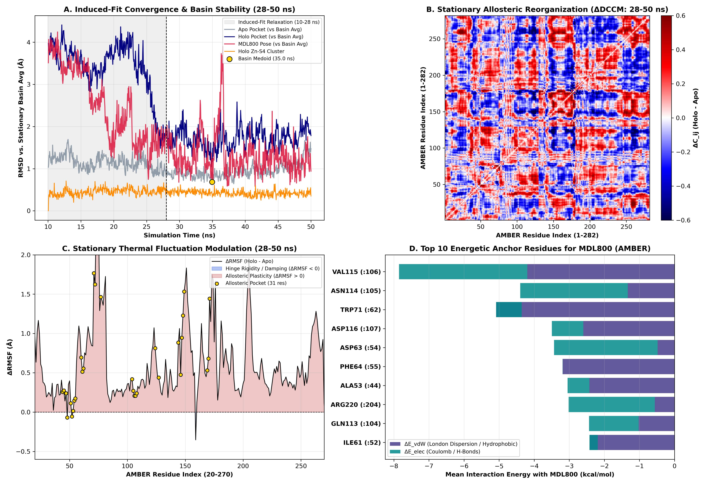

# SIRT6 Allosteric Rescue: Automated QM/MM, Ensemble Docking & Holo-MD Pipeline


An end-to-end, reproducible computational biophysics workflow orchestrated via **Snakemake** to elucidate the allosteric activation mechanism of human **SIRT6** (`PDB: 5MF6`) by the small-molecule activator **MDL800**, benchmarked against the unliganded (*Apo*) ensemble, the crystallographic control (**UBCS039**), and the negative control (**NAM**).

---

## 1. Biophysical Architecture & Workflow

1. **Quantum Mechanical Metal-Center Parameterization (`Zn-S4`):** The structural Zinc-binding domain (`CYS141`, `CYS144`, `CYS166`, `CYS177` -> `CM1-CM4` + `ZN1`) is parameterized from first principles using **GAMESS-US** (`B3LYP/6-31G*` geometry optimization, Seminario Hessian force-constant projection, and Merz-Kollman `RESP` charge fitting) coupled to `MCPB.py`.
2. **Apo Conformational Sampling (`50 ns`):** Explicit-solvent molecular dynamics in **OpenMM 8.6** (`AMBER ff19SB` + `OPC` water + `GAFF2` at `300 K` and `1 bar`), followed by K-means clustering (`k = 5`) across the 31-residue allosteric pocket over the equilibrated `10-50 ns` window.
3. **Boltzmann-Weighted Ensemble Docking (`GNINA 1.3`):** Hybrid physical (`Vina`) and 3D convolutional neural network (`CNNscore` / `CNNaffinity`) docking across the static crystal receptor (`dry`) and the top 4 dynamic *Apo* centroids (`c0-c3`), penalized by conformational free energy (Δ<i>G</i><sub>conf</sub> = −<i>RT</i> ln(<i>p<sub>i</sub></i> / <i>p</i><sub>0</sub>)).
4. **Holo-MD Production (`SIRT6_c1 + Zn + MDL800`, `50 ns`) & Allosteric Rescue Analysis:** `GAFF2/AM1-BCC` ligand parameterization via `ANTECHAMBER/sqm`, multi-stage harmonic-shielded `NVT/NPT` equilibration (<i>k</i>: 10.0 → 0.0 kcal/mol/Ų), 50 ns production MD, and stationary-basin (`28-50 ns`) analysis (ΔRMSF, ΔDCCM, H-bond network, and exact AMBER non-bonded per-residue energy decomposition).

---

## 2. Key Quantitative Results

### 2.1. Ensemble Docking Thermodynamics (`results/docking/ensemble_detailed.csv`)

Redocking of the crystallographic control **UBCS039** into the static receptor (`dry`) recovered the experimental pose within **`0.89 Å`** (`Crystal_RMSD_Best`). While the static crystal pocket (`dry`) sterically penalized the bulkier **MDL800** activator (`CNNscore = 0.316`), conformational breathing during *Apo*-MD opened microstate **`c1` (27.4% population)**, doubling its neural pose probability (**`CNNscore = 0.677`**) and achieving the highest predicted affinity (**`CNNaffinity = 7.25`**, **`E_eff = -8.46 kcal/mol`**):

| Ligand | Weighted Vina (kcal/mol) | Optimal State | Best E_eff (kcal/mol) | Weighted CNNaffinity | Peak CNNaffinity (c1) | CNNscore (Selected) |
| :--- | :---: | :---: | :---: | :---: | :---: | :---: |
| **MDL800** (Activator) | **-8.53** | `c1` / `c2` | **-8.46** (`c1`) | **6.99** | **7.25** | **0.677** (`c1`) |
| **UBCS039** (Control +) | -6.93 | `c0` | -7.02 (`c0`) | 4.99 | 4.60 | 0.640 (`c0`) |
| **NAM** (Control -) | -4.88 | `c0` | -4.96 (`c0`) | 3.87 | 3.81 | 0.978 (`c0`) |

---

### 2.2. Stationary-Basin Stability & Energetics Post-*Induced-Fit* (`28-50 ns`)

Following a cooperative *Induced-Fit* relaxation (`10-28 ns`), the ternary `SIRT6-Zn-MDL800` complex converged into a rigid thermodynamic basin (`28-50 ns`, medoid structure exported at **`34.95 ns` / Frame 699**):

| Biophysical Metric (Stationary Basin: 28-50 ns) | Apo (Mean ± SD) | Holo-MDL800 (Mean ± SD) |
| :--- | :---: | :---: |
| **Folded Core Backbone RMSD (`:25-265`) (Å)** | 0.65 ± 0.11 | 1.33 ± 0.18 |
| **Zn-S4 Quantum Tetrahedron RMSD (Å)** | 0.43 ± 0.09 | **0.42 ± 0.07** |
| **Allosteric Pocket Basin RMSD (Å)** | 0.95 ± 0.17 | 1.72 ± 0.25 |
| **MDL800 Pose RMSD in Basin (`nofit`) (Å)** | N/A | **1.31 ± 0.47** |
| **MDL800 Internal Torsional RMSD (Å)** | N/A | **0.57 ± 0.21** |
| **Total Protein-MDL800 Non-Bonded Energy (kcal/mol)** | N/A | **-49.87** (`vdW: -39.65`, `Elec: -10.20`) |



---

### 2.3. Top 10 Per-Residue Energetic Anchors of MDL800 (`results/analysis/mdl800_per_residue_energy.csv`)

Exact decomposition of the AMBER Hamiltonian across the stationary basin reveals that **MDL800** binding is driven **79.5% by London dispersion forces (Δ<i>E</i><sub>vdW</sub> = −39.65 kcal/mol)** against the hydrophobic/aromatic cage (`TRP71`, `VAL115`, `PHE64`, `ILE61`) and **20.5% by electrostatic interactions (Δ<i>E</i><sub>elec</sub> = −10.20 kcal/mol)** anchored by a persistent bifurcated backbone hydrogen bond to **`VAL115` (`46.6%` occupancy)** and **`ASP116` (`13.6%`)**, alongside long-range *Induced-Fit* recruitment of **`ARG220`**:

| AMBER Index | Crystal Residue (`5MF6`) | Δ<i>E</i><sub>vdW</sub> (kcal/mol) | Δ<i>E</i><sub>elec</sub> (kcal/mol) | Δ<i>E</i><sub>total</sub> (kcal/mol) | Allosteric Pocket (`< 8 Å` Crystal) |
| :---: | :---: | :---: | :---: | :---: | :---: |
| `:106` | **VAL115** | -4.196 | -3.656 | **-7.852** | True |
| `:105` | **ASN114** | -1.332 | -3.064 | **-4.396** | True |
| `:62` | **TRP71** | -5.084 | +0.730 | **-4.355** | True |
| `:107` | **ASP116** | -2.600 | -0.895 | **-3.495** | True |
| `:54` | **ASP63** | -0.481 | -2.953 | **-3.434** | True |
| `:55` | **PHE64** | -3.190 | +0.002 | **-3.188** | True |
| `:44` | **ALA53** | -2.428 | -0.621 | **-3.048** | True |
| `:204` | **ARG220** | -0.563 | -2.455 | **-3.018** | False (*Induced-Fit* Recruitment) |
| `:104` | **GLN113** | -1.022 | -1.413 | **-2.434** | True |
| `:52` | **ILE61** | -2.424 | +0.234 | **-2.190** | True |

---

## 3. Repository Structure & Execution

```text
sirt6-allosteric-rescue/
├── config/config.yaml                  # System & simulation parameters (PDB: 5MF6)
├── data/raw/5MF6.pdb                   # Crystallographic reference structure
├── scripts/                            # Modular Python & PyMOL (.pml) scripts
├── results/
│   ├── mcpb/                           # Quantum Zn-S4 parameters (.frcmod, .mol2)
│   ├── clustering/                     # Allosteric pocket box & Apo cluster populations
│   ├── docking/                        # Boltzmann ensemble tables (.csv) & docked poses (.sdf)
│   ├── holo_mdl800/                    # GAFF2/AM1-BCC parameters for MDL800 (.mol2, .frcmod)
│   └── analysis/                       # 4-panel dashboard, energy tables & 3D medoid (.pdb)
├── environment.yaml                    # Reproducible Conda/Mamba environment (CUDA 12.8)
└── Snakefile                           # Automated Snakemake DAG orchestrator
```

### Reproducing the Workflow & 3D Visualization

```bash
# 1. Create and activate the unified CUDA 12.8 environment
mamba env create -f environment.yaml
conda activate sirt6-env

# 2. Execute the complete Snakemake DAG
snakemake --cores 6

# 3. Render the stationary Holo medoid complex in PyMOL
pymol scripts/render_pymol.pml
```
